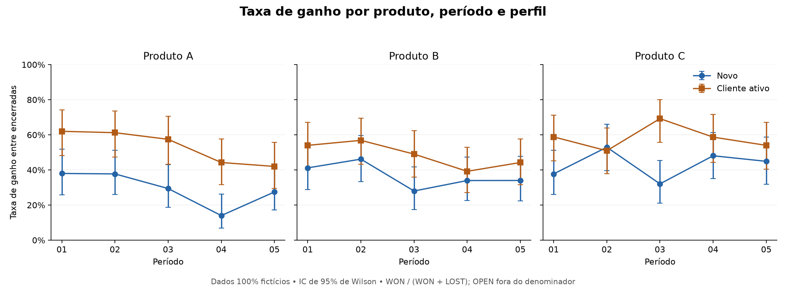
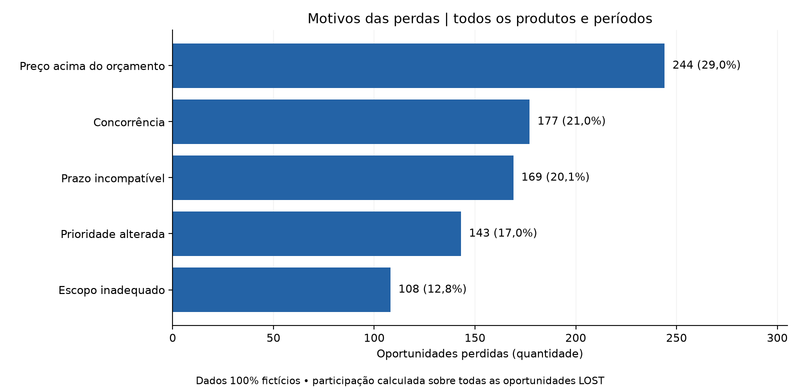

# Análise de Conversão de Vendas

**Taxas de ganho, perfis de clientes e motivos de perda para apoiar decisões comerciais com Python.**

Projeto de portfólio com validação de dados, indicadores por produto e período, visualizações e resultados reproduzíveis.

> Todos os dados, valores e resultados apresentados são **100% fictícios**, gerados por código, sem uso de bases ou parâmetros empresariais privados.

## Perguntas respondidas

- Como varia a taxa de ganho entre produtos e períodos?
- Como se comparam novos clientes e clientes ativos?
- Quais motivos concentram as oportunidades perdidas?
- Como combinar volume, taxa e valor para investigar oportunidades comerciais?

<!-- RESULTADOS:SINTETICOS:INICIO -->
## Resultados da demonstração

**1.650 oportunidades fictícias · 1.524 encerradas · 683 ganhos · 126 abertas.**

### Conversão por produto

| Produto | Encerradas | Ganhos | Abertas | Taxa de ganho | IC 95% | Valor ganho simulado (R$) |
|---|---:|---:|---:|---:|---:|---:|
| Produto A | 503 | 207 | 47 | 41,2% | 36,9%–45,5% | 2.028.426,92 |
| Produto B | 511 | 218 | 39 | 42,7% | 38,4%–47,0% | 2.453.117,69 |
| Produto C | 510 | 258 | 40 | 50,6% | 46,3%–54,9% | 3.184.053,82 |

Taxa geral: **44,8%**, calculada pela soma dos ganhos dividida pela soma das encerradas.



O gráfico compara novos clientes e clientes ativos. O perfil interno `Recompra` é apresentado como **Cliente ativo** e mantém a definição original de atividade nos últimos dois anos.

### Composição das perdas



| Motivo | Quantidade | Participação nas perdas | Acumulado |
|---|---:|---:|---:|
| Preço acima do orçamento | 244 | 29,0% | 29,0% |
| Concorrência | 177 | 21,0% | 50,1% |
| Prazo incompatível | 169 | 20,1% | 70,2% |
| Prioridade alterada | 143 | 17,0% | 87,2% |
| Escopo inadequado | 108 | 12,8% | 100,0% |

### Leitura de negócio

- Na simulação, **Produto C** apresenta a maior taxa agregada de ganho (50,6%).
- **Preço acima do orçamento** concentra 29,0% das perdas simuladas; esse recorte exemplifica como priorizar investigações comerciais.
- A comparação por perfil e período ajuda a distinguir mudanças de composição de mudanças na taxa de ganho.

Fonte: `scripts/gerar_dados_sinteticos.py`, seed `2026`; tabelas e imagens reproduzidas por `python scripts/gerar_portfolio.py`. Estes resultados demonstram o método e não representam desempenho de empresas reais.
<!-- RESULTADOS:SINTETICOS:FIM -->

## Como funciona

A taxa usa **WON / (WON + LOST)**. Oportunidades abertas são contabilizadas separadamente. Os totais usam numeradores e denominadores agregados.

## Metodologias e boas práticas

| Método | O que demonstra | Por que foi utilizado |
|---|---|---|
| Taxa entre encerradas e Wilson | Desfecho conhecido com IC de 95% | Dá contexto de amostra à taxa e mantém abertas separadas |
| Newcombe e Z/Fisher | Diferença entre novos e clientes ativos | Quantifica a diferença e escolhe o teste conforme as contagens |
| Pareto | Concentração por motivo de perda | Ajuda a priorizar investigações por quantidade ou valor |
| Qui-quadrado/Fisher/Monte Carlo e V de Cramér | Associação categórica e magnitude | Trata tabelas esparsas e acompanha o tamanho de efeito |
| Kruskal–Wallis | Distribuição dos valores entre categorias | Compara grupos sem pressupor normalidade |
| BH-FDR | Comparações múltiplas | Ajusta famílias completas de testes exploratórios |

**Controles aplicados:** Grão e IDs únicos; abertas separadas; ausências preservadas; testes definidos pelas contagens; ICs e efeitos acompanhados de amostra; publicação conferida contra a simulação.

Leia o [relatório completo com resultados e interpretações](docs/relatorio.md) e o [guia metodológico com fórmulas e justificativas](docs/metodologia.md).

## Executar no VS Code

No terminal PowerShell, dentro deste repositório:

```powershell
python -m venv .venv
.\.venv\Scripts\Activate.ps1
python -m pip install -r requirements.txt
python scripts/gerar_dados_sinteticos.py
python conversao_produto.py --base Vendas
python scripts/gerar_portfolio.py
python -m pytest -q
```

- `gerar_dados_sinteticos.py`: recria a base fictícia com seed fixa.
- O script analítico gera resultados locais em `outputs/conversao/` (Excel analítico e gráficos).
- `gerar_portfolio.py`: atualiza estas tabelas, o relatório em `docs/relatorio.md` e as imagens em `docs/assets/`, sempre com dados fictícios.
- `pytest`: verifica cálculos, validação e compatibilidade.

## Dados e documentação

| Campo atual | Significado |
|---|---|
| `Base` | Categoria da base; a demonstração usa `Vendas`. |
| `Período` | Identificador ordenado da janela analisada. |
| `Cliente ativo?` | Atividade nos últimos dois anos; mesma regra anterior. |

Os cabeçalhos anteriores continuam aceitos para compatibilidade. Os identificadores dos períodos e as fórmulas são preservados.

Consulte o [guia técnico e dicionário de dados](docs/metodologia.md) para regras, testes exploratórios e uso local de dados privados.

**Tecnologias:** Python · pandas · NumPy · SciPy · Matplotlib · pytest.

## Atualizar no GitHub

Depois de salvar as alterações e regenerar os dados e as imagens:

```powershell
git status --short
git add .
python scripts/verificar_publicacao.py
git diff --cached --stat
```

Se a verificação passar, revise os arquivos preparados e publique:

```powershell
git commit -m "Atualiza análise e apresentação dos resultados"
git push
git status --short --branch
```

`add` prepara os arquivos; a verificação confere a base e as imagens sintéticas; `commit` registra a versão local; `push` envia ao GitHub. Se algum comando falhar, interrompa a sequência e confira a mensagem.
