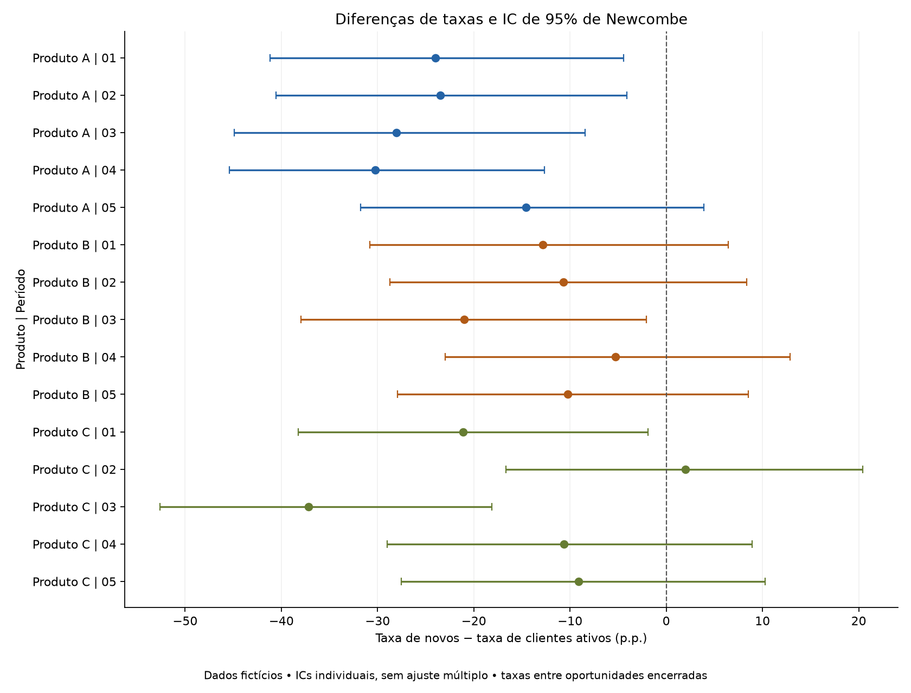

# Relatório de conversão de vendas com dados fictícios

Relatório gerado por código, com leitura executiva, evidências e decisões metodológicas. Todos os registros, categorias e valores foram inventados pelo gerador deste projeto (seed 2026).

## Resumo executivo

A simulação contém **1.650 oportunidades**, das quais **1.524 encerradas** e **683 ganhas**. A taxa geral de ganho é **44,8%**. A leitura combina taxa, volume, perfil e composição das perdas para orientar investigações comerciais.

Os indicadores descrevem oportunidades encerradas. A relação de atividade nos últimos dois anos define o perfil de cliente ativo; o segmento interno `Recompra` mantém essa mesma regra.

## Evolução por período

| Período | Oportunidades | Encerradas | Ganhos | Perdas | Abertas | Taxa de ganho |
|---|---|---|---|---|---|---|
| Ciclo 01 | 330 | 305 | 148 | 157 | 25 | 48,5% |
| Ciclo 02 | 330 | 309 | 157 | 152 | 21 | 50,8% |
| Ciclo 03 | 330 | 304 | 134 | 170 | 26 | 44,1% |
| Ciclo 04 | 330 | 304 | 120 | 184 | 26 | 39,5% |
| Ciclo 05 | 330 | 302 | 124 | 178 | 28 | 41,1% |

**Método e motivo:** `WON / (WON + LOST)` usa apenas desfechos encerrados. As abertas são mostradas separadamente para dar visibilidade ao volume ainda sem desfecho. O total é calculado como razão entre as somas, preservando o peso dos grupos. Diferenças de prazo para fechamento exigiriam análise de coorte específica.


## Comparação entre novos clientes e clientes ativos



A diferença segue **Novo − Cliente ativo**, em pontos percentuais. Valores negativos indicam taxa menor para novos naquela combinação de produto e período. Cada intervalo de 95% é individual, sem ajuste para múltiplas comparações; a coluna q ajusta os testes da família completa de 15 comparações.

| Produto | Período | n novo | n ativo | Novo | Ativo | Diferença (p.p.) | IC 95% (p.p.) | Teste | p | q BH |
|---|---|---|---|---|---|---|---|---|---|---|
| Produto A | Ciclo 01 | 50 | 50 | 38,0% | 62,0% | -24,0 | -41,2 a -4,4 | Z duas proporções | 0,016395 | 0,053239 |
| Produto A | Ciclo 02 | 53 | 49 | 37,7% | 61,2% | -23,5 | -40,6 a -4,1 | Z duas proporções | 0,017746 | 0,053239 |
| Produto A | Ciclo 03 | 51 | 47 | 29,4% | 57,4% | -28,0 | -44,9 a -8,4 | Z duas proporções | 0,005083 | 0,025413 |
| Produto A | Ciclo 04 | 50 | 52 | 14,0% | 44,2% | -30,2 | -45,4 a -12,7 | Z duas proporções | 0,000809 | 0,006067 |
| Produto A | Ciclo 05 | 51 | 50 | 27,5% | 42,0% | -14,5 | -31,8 a 3,9 | Z duas proporções | 0,124480 | 0,233400 |
| Produto B | Ciclo 01 | 51 | 50 | 41,2% | 54,0% | -12,8 | -30,8 a 6,5 | Z duas proporções | 0,196958 | 0,328263 |
| Produto B | Ciclo 02 | 52 | 51 | 46,2% | 56,9% | -10,7 | -28,7 a 8,3 | Z duas proporções | 0,276929 | 0,366458 |
| Produto B | Ciclo 03 | 50 | 51 | 28,0% | 49,0% | -21,0 | -38,0 a -2,0 | Z duas proporções | 0,030057 | 0,067327 |
| Produto B | Ciclo 04 | 53 | 51 | 34,0% | 39,2% | -5,3 | -23,0 a 12,9 | Z duas proporções | 0,578085 | 0,619377 |
| Produto B | Ciclo 05 | 50 | 52 | 34,0% | 44,2% | -10,2 | -28,0 a 8,5 | Z duas proporções | 0,290074 | 0,366458 |
| Produto C | Ciclo 01 | 53 | 51 | 37,7% | 58,8% | -21,1 | -38,2 a -1,9 | Z duas proporções | 0,031419 | 0,067327 |
| Produto C | Ciclo 02 | 51 | 53 | 52,9% | 50,9% | 2,0 | -16,6 a 20,4 | Z duas proporções | 0,838473 | 0,838473 |
| Produto C | Ciclo 03 | 53 | 52 | 32,1% | 69,2% | -37,2 | -52,6 a -18,1 | Z duas proporções | 0,000141 | 0,002108 |
| Produto C | Ciclo 04 | 52 | 46 | 48,1% | 58,7% | -10,6 | -29,0 a 8,9 | Z duas proporções | 0,293166 | 0,366458 |
| Produto C | Ciclo 05 | 49 | 50 | 44,9% | 54,0% | -9,1 | -27,5 a 10,3 | Z duas proporções | 0,365126 | 0,421299 |

**Métodos e motivos:** Wilson descreve a incerteza de cada proporção; Newcombe combina os intervalos de Wilson para estimar a diferença entre dois grupos independentes. O teste Z compara proporções quando todas as frequências esperadas são pelo menos cinco; em tabelas 2×2 esparsas, o código usa Fisher bilateral. A implementação trata explicitamente grupos sem encerradas e desfechos degenerados.

## Concentração dos motivos de perda


O conjunto que alcança ou ultrapassa 80% reúne **4 motivos**, com **87,2%** das perdas da simulação. A análise de Pareto é uma regra de priorização; a proporção 80/20 não é imposta aos dados.

**Método e motivo:** ordenar contagens e participações acumuladas permite dimensionar quais motivos merecem investigação primeiro. A mesma lógica pode usar valores completos das oportunidades; esses valores representam exposição comercial, sem equivaler a receita perdida comprovada.

## Associação entre motivos e perfis ou fases

| Produto | Período | Comparação | Perdas | Teste aplicado | Menor esperado | V de Cramér | p | q BH |
|---|---|---|---|---|---|---|---|---|
| Produto A | Ciclo 01 | tipo_cliente x motivo | 50 | Qui-quadrado Monte Carlo (9999) | 1,90 | 0,250 | 0,560200 | 0,957333 |
| Produto A | Ciclo 01 | fase x motivo | 50 | Qui-quadrado Monte Carlo (9999) | 0,10 | 0,312 | 0,260500 | 0,957333 |
| Produto A | Ciclo 02 | tipo_cliente x motivo | 52 | Qui-quadrado Monte Carlo (9999) | 1,10 | 0,364 | 0,144100 | 0,956500 |
| Produto A | Ciclo 02 | fase x motivo | 52 | Qui-quadrado Monte Carlo (9999) | 0,23 | 0,416 | 0,006400 | 0,096000 |
| Produto A | Ciclo 03 | tipo_cliente x motivo | 56 | Qui-quadrado Monte Carlo (9999) | 1,79 | 0,270 | 0,410400 | 0,957333 |
| Produto A | Ciclo 03 | fase x motivo | 56 | Qui-quadrado Monte Carlo (9999) | 0,36 | 0,221 | 0,810700 | 0,994600 |
| Produto A | Ciclo 04 | tipo_cliente x motivo | 72 | Qui-quadrado Monte Carlo (9999) | 2,42 | 0,209 | 0,550900 | 0,957333 |
| Produto A | Ciclo 04 | fase x motivo | 72 | Qui-quadrado Monte Carlo (9999) | 0,67 | 0,190 | 0,836700 | 0,994600 |
| Produto A | Ciclo 05 | tipo_cliente x motivo | 66 | Qui-quadrado Monte Carlo (9999) | 3,52 | 0,189 | 0,696700 | 0,994600 |
| Produto A | Ciclo 05 | fase x motivo | 66 | Qui-quadrado Monte Carlo (9999) | 0,85 | 0,163 | 0,962800 | 0,994600 |
| Produto B | Ciclo 01 | tipo_cliente x motivo | 53 | Qui-quadrado Monte Carlo (9999) | 3,47 | 0,089 | 0,994600 | 0,994600 |
| Produto B | Ciclo 01 | fase x motivo | 53 | Qui-quadrado Monte Carlo (9999) | 0,91 | 0,271 | 0,488900 | 0,957333 |
| Produto B | Ciclo 02 | tipo_cliente x motivo | 50 | Qui-quadrado Monte Carlo (9999) | 2,20 | 0,144 | 0,926100 | 0,994600 |
| Produto B | Ciclo 02 | fase x motivo | 50 | Qui-quadrado Monte Carlo (9999) | 0,20 | 0,307 | 0,290200 | 0,957333 |
| Produto B | Ciclo 03 | tipo_cliente x motivo | 62 | Qui-quadrado Monte Carlo (9999) | 2,10 | 0,230 | 0,537800 | 0,957333 |
| Produto B | Ciclo 03 | fase x motivo | 62 | Qui-quadrado Monte Carlo (9999) | 0,40 | 0,244 | 0,549800 | 0,957333 |
| Produto B | Ciclo 04 | tipo_cliente x motivo | 66 | Qui-quadrado Monte Carlo (9999) | 3,76 | 0,306 | 0,191300 | 0,956500 |
| Produto B | Ciclo 04 | fase x motivo | 66 | Qui-quadrado Monte Carlo (9999) | 1,45 | 0,234 | 0,574400 | 0,957333 |
| Produto B | Ciclo 05 | tipo_cliente x motivo | 62 | Qui-quadrado Monte Carlo (9999) | 3,27 | 0,317 | 0,188300 | 0,956500 |
| Produto B | Ciclo 05 | fase x motivo | 62 | Qui-quadrado Monte Carlo (9999) | 0,79 | 0,213 | 0,786200 | 0,994600 |
| Produto C | Ciclo 01 | tipo_cliente x motivo | 54 | Qui-quadrado Monte Carlo (9999) | 1,94 | 0,504 | 0,006300 | 0,096000 |
| Produto C | Ciclo 01 | fase x motivo | 54 | Qui-quadrado Monte Carlo (9999) | 0,65 | 0,235 | 0,745700 | 0,994600 |
| Produto C | Ciclo 02 | tipo_cliente x motivo | 50 | Qui-quadrado Monte Carlo (9999) | 3,36 | 0,295 | 0,372700 | 0,957333 |
| Produto C | Ciclo 02 | fase x motivo | 50 | Qui-quadrado Monte Carlo (9999) | 0,98 | 0,348 | 0,104400 | 0,956500 |
| Produto C | Ciclo 03 | tipo_cliente x motivo | 52 | Qui-quadrado Monte Carlo (9999) | 1,54 | 0,252 | 0,534500 | 0,957333 |
| Produto C | Ciclo 03 | fase x motivo | 52 | Qui-quadrado Monte Carlo (9999) | 0,38 | 0,267 | 0,548200 | 0,957333 |
| Produto C | Ciclo 04 | tipo_cliente x motivo | 46 | Qui-quadrado Monte Carlo (9999) | 1,65 | 0,229 | 0,710400 | 0,994600 |
| Produto C | Ciclo 04 | fase x motivo | 46 | Qui-quadrado Monte Carlo (9999) | 0,35 | 0,244 | 0,810500 | 0,994600 |
| Produto C | Ciclo 05 | tipo_cliente x motivo | 50 | Qui-quadrado Monte Carlo (9999) | 1,84 | 0,148 | 0,932900 | 0,994600 |
| Produto C | Ciclo 05 | fase x motivo | 50 | Qui-quadrado Monte Carlo (9999) | 0,56 | 0,191 | 0,961100 | 0,994600 |

**Métodos e motivos:** qui-quadrado avalia associação em tabelas categóricas; Fisher é usado para tabelas 2×2 esparsas e Monte Carlo para tabelas maiores com frequências esperadas pequenas. São 9.999 reamostragens, com seed 90210. V de Cramér informa a magnitude da associação. As 30 comparações formam uma família BH própria, sem selecionar apenas p-valores favoráveis.

## Distribuição dos valores ganhos

| Produto | Ganhos | Média (R$) | Mediana (R$) | P25 (R$) | P75 (R$) |
|---|---|---|---|---|---|
| Produto A | 207 | 9.799,16 | 8.416,56 | 5.821,18 | 12.233,98 |
| Produto B | 218 | 11.252,83 | 9.759,43 | 6.723,83 | 13.813,46 |
| Produto C | 258 | 12.341,29 | 10.251,72 | 7.152,47 | 16.256,42 |

**Método e motivo:** média e mediana são apresentadas com quartis para descrever valores assimétricos. A mediana informa o centro da distribuição; a dispersão é examinada pelos quartis. Os valores são preservados, sem remoção automática de extremos ou preenchimento de ausências com zero.

### Comparações de valores por fase ou motivo

**6 comparações atendem aos critérios de cálculo** da simulação. A tabela principal mostra essas comparações; o registro integral das 60 combinações fica disponível abaixo para auditoria.

| Produto | Período | Perfil interno | Comparação | Grupos | H | Epsilon² | p | q BH |
|---|---|---|---|---|---|---|---|---|
| Produto A | Ciclo 04 | Novo | valor x fase | 4 | 6,193 | 0,082 | 0,102567 | 0,355748 |
| Produto A | Ciclo 05 | Novo | valor x motivo_perda | 5 | 3,701 | 0,000 | 0,447991 | 0,671987 |
| Produto B | Ciclo 04 | Novo | valor x fase | 4 | 5,861 | 0,092 | 0,118583 | 0,355748 |
| Produto B | Ciclo 04 | Novo | valor x motivo_perda | 5 | 2,258 | 0,000 | 0,688391 | 0,740076 |
| Produto B | Ciclo 04 | Recompra | valor x fase | 4 | 1,254 | 0,000 | 0,740076 | 0,740076 |
| Produto C | Ciclo 05 | Novo | valor x fase | 4 | 4,211 | 0,053 | 0,239595 | 0,479190 |

<details>
<summary>Consultar o registro completo das 60 combinações</summary>

| Produto | Período | Perfil interno | Comparação | Grupos | Situação / método | H | Epsilon² | p | q BH |
|---|---|---|---|---|---|---|---|---|---|
| Produto A | Ciclo 01 | Novo | valor x fase | 4 | Grupos insuficientes (mínimo 5 valores/grupo) | — | — | — | — |
| Produto A | Ciclo 01 | Novo | valor x motivo_perda | 5 | Grupos insuficientes (mínimo 5 valores/grupo) | — | — | — | — |
| Produto A | Ciclo 01 | Recompra | valor x fase | 3 | Grupos insuficientes (mínimo 5 valores/grupo) | — | — | — | — |
| Produto A | Ciclo 01 | Recompra | valor x motivo_perda | 5 | Grupos insuficientes (mínimo 5 valores/grupo) | — | — | — | — |
| Produto A | Ciclo 02 | Novo | valor x fase | 4 | Grupos insuficientes (mínimo 5 valores/grupo) | — | — | — | — |
| Produto A | Ciclo 02 | Novo | valor x motivo_perda | 5 | Grupos insuficientes (mínimo 5 valores/grupo) | — | — | — | — |
| Produto A | Ciclo 02 | Recompra | valor x fase | 4 | Grupos insuficientes (mínimo 5 valores/grupo) | — | — | — | — |
| Produto A | Ciclo 02 | Recompra | valor x motivo_perda | 5 | Grupos insuficientes (mínimo 5 valores/grupo) | — | — | — | — |
| Produto A | Ciclo 03 | Novo | valor x fase | 4 | Grupos insuficientes (mínimo 5 valores/grupo) | — | — | — | — |
| Produto A | Ciclo 03 | Novo | valor x motivo_perda | 5 | Grupos insuficientes (mínimo 5 valores/grupo) | — | — | — | — |
| Produto A | Ciclo 03 | Recompra | valor x fase | 4 | Grupos insuficientes (mínimo 5 valores/grupo) | — | — | — | — |
| Produto A | Ciclo 03 | Recompra | valor x motivo_perda | 5 | Grupos insuficientes (mínimo 5 valores/grupo) | — | — | — | — |
| Produto A | Ciclo 04 | Novo | valor x fase | 4 | Kruskal-Wallis (distribuições; sem interpretação causal) | 6,193 | 0,082 | 0,102567 | 0,355748 |
| Produto A | Ciclo 04 | Novo | valor x motivo_perda | 5 | Grupos insuficientes (mínimo 5 valores/grupo) | — | — | — | — |
| Produto A | Ciclo 04 | Recompra | valor x fase | 4 | Grupos insuficientes (mínimo 5 valores/grupo) | — | — | — | — |
| Produto A | Ciclo 04 | Recompra | valor x motivo_perda | 5 | Grupos insuficientes (mínimo 5 valores/grupo) | — | — | — | — |
| Produto A | Ciclo 05 | Novo | valor x fase | 4 | Grupos insuficientes (mínimo 5 valores/grupo) | — | — | — | — |
| Produto A | Ciclo 05 | Novo | valor x motivo_perda | 5 | Kruskal-Wallis (distribuições; sem interpretação causal) | 3,701 | 0,000 | 0,447991 | 0,671987 |
| Produto A | Ciclo 05 | Recompra | valor x fase | 4 | Grupos insuficientes (mínimo 5 valores/grupo) | — | — | — | — |
| Produto A | Ciclo 05 | Recompra | valor x motivo_perda | 5 | Grupos insuficientes (mínimo 5 valores/grupo) | — | — | — | — |
| Produto B | Ciclo 01 | Novo | valor x fase | 4 | Grupos insuficientes (mínimo 5 valores/grupo) | — | — | — | — |
| Produto B | Ciclo 01 | Novo | valor x motivo_perda | 5 | Grupos insuficientes (mínimo 5 valores/grupo) | — | — | — | — |
| Produto B | Ciclo 01 | Recompra | valor x fase | 4 | Grupos insuficientes (mínimo 5 valores/grupo) | — | — | — | — |
| Produto B | Ciclo 01 | Recompra | valor x motivo_perda | 5 | Grupos insuficientes (mínimo 5 valores/grupo) | — | — | — | — |
| Produto B | Ciclo 02 | Novo | valor x fase | 4 | Grupos insuficientes (mínimo 5 valores/grupo) | — | — | — | — |
| Produto B | Ciclo 02 | Novo | valor x motivo_perda | 5 | Grupos insuficientes (mínimo 5 valores/grupo) | — | — | — | — |
| Produto B | Ciclo 02 | Recompra | valor x fase | 4 | Grupos insuficientes (mínimo 5 valores/grupo) | — | — | — | — |
| Produto B | Ciclo 02 | Recompra | valor x motivo_perda | 5 | Grupos insuficientes (mínimo 5 valores/grupo) | — | — | — | — |
| Produto B | Ciclo 03 | Novo | valor x fase | 4 | Grupos insuficientes (mínimo 5 valores/grupo) | — | — | — | — |
| Produto B | Ciclo 03 | Novo | valor x motivo_perda | 5 | Grupos insuficientes (mínimo 5 valores/grupo) | — | — | — | — |
| Produto B | Ciclo 03 | Recompra | valor x fase | 4 | Grupos insuficientes (mínimo 5 valores/grupo) | — | — | — | — |
| Produto B | Ciclo 03 | Recompra | valor x motivo_perda | 5 | Grupos insuficientes (mínimo 5 valores/grupo) | — | — | — | — |
| Produto B | Ciclo 04 | Novo | valor x fase | 4 | Kruskal-Wallis (distribuições; sem interpretação causal) | 5,861 | 0,092 | 0,118583 | 0,355748 |
| Produto B | Ciclo 04 | Novo | valor x motivo_perda | 5 | Kruskal-Wallis (distribuições; sem interpretação causal) | 2,258 | 0,000 | 0,688391 | 0,740076 |
| Produto B | Ciclo 04 | Recompra | valor x fase | 4 | Kruskal-Wallis (distribuições; sem interpretação causal) | 1,254 | 0,000 | 0,740076 | 0,740076 |
| Produto B | Ciclo 04 | Recompra | valor x motivo_perda | 5 | Grupos insuficientes (mínimo 5 valores/grupo) | — | — | — | — |
| Produto B | Ciclo 05 | Novo | valor x fase | 4 | Grupos insuficientes (mínimo 5 valores/grupo) | — | — | — | — |
| Produto B | Ciclo 05 | Novo | valor x motivo_perda | 5 | Grupos insuficientes (mínimo 5 valores/grupo) | — | — | — | — |
| Produto B | Ciclo 05 | Recompra | valor x fase | 4 | Grupos insuficientes (mínimo 5 valores/grupo) | — | — | — | — |
| Produto B | Ciclo 05 | Recompra | valor x motivo_perda | 5 | Grupos insuficientes (mínimo 5 valores/grupo) | — | — | — | — |
| Produto C | Ciclo 01 | Novo | valor x fase | 4 | Grupos insuficientes (mínimo 5 valores/grupo) | — | — | — | — |
| Produto C | Ciclo 01 | Novo | valor x motivo_perda | 5 | Grupos insuficientes (mínimo 5 valores/grupo) | — | — | — | — |
| Produto C | Ciclo 01 | Recompra | valor x fase | 4 | Grupos insuficientes (mínimo 5 valores/grupo) | — | — | — | — |
| Produto C | Ciclo 01 | Recompra | valor x motivo_perda | 5 | Grupos insuficientes (mínimo 5 valores/grupo) | — | — | — | — |
| Produto C | Ciclo 02 | Novo | valor x fase | 4 | Grupos insuficientes (mínimo 5 valores/grupo) | — | — | — | — |
| Produto C | Ciclo 02 | Novo | valor x motivo_perda | 5 | Grupos insuficientes (mínimo 5 valores/grupo) | — | — | — | — |
| Produto C | Ciclo 02 | Recompra | valor x fase | 4 | Grupos insuficientes (mínimo 5 valores/grupo) | — | — | — | — |
| Produto C | Ciclo 02 | Recompra | valor x motivo_perda | 5 | Grupos insuficientes (mínimo 5 valores/grupo) | — | — | — | — |
| Produto C | Ciclo 03 | Novo | valor x fase | 4 | Grupos insuficientes (mínimo 5 valores/grupo) | — | — | — | — |
| Produto C | Ciclo 03 | Novo | valor x motivo_perda | 5 | Grupos insuficientes (mínimo 5 valores/grupo) | — | — | — | — |
| Produto C | Ciclo 03 | Recompra | valor x fase | 4 | Grupos insuficientes (mínimo 5 valores/grupo) | — | — | — | — |
| Produto C | Ciclo 03 | Recompra | valor x motivo_perda | 5 | Grupos insuficientes (mínimo 5 valores/grupo) | — | — | — | — |
| Produto C | Ciclo 04 | Novo | valor x fase | 4 | Grupos insuficientes (mínimo 5 valores/grupo) | — | — | — | — |
| Produto C | Ciclo 04 | Novo | valor x motivo_perda | 5 | Grupos insuficientes (mínimo 5 valores/grupo) | — | — | — | — |
| Produto C | Ciclo 04 | Recompra | valor x fase | 4 | Grupos insuficientes (mínimo 5 valores/grupo) | — | — | — | — |
| Produto C | Ciclo 04 | Recompra | valor x motivo_perda | 5 | Grupos insuficientes (mínimo 5 valores/grupo) | — | — | — | — |
| Produto C | Ciclo 05 | Novo | valor x fase | 4 | Kruskal-Wallis (distribuições; sem interpretação causal) | 4,211 | 0,053 | 0,239595 | 0,479190 |
| Produto C | Ciclo 05 | Novo | valor x motivo_perda | 5 | Grupos insuficientes (mínimo 5 valores/grupo) | — | — | — | — |
| Produto C | Ciclo 05 | Recompra | valor x fase | 4 | Grupos insuficientes (mínimo 5 valores/grupo) | — | — | — | — |
| Produto C | Ciclo 05 | Recompra | valor x motivo_perda | 5 | Grupos insuficientes (mínimo 5 valores/grupo) | — | — | — | — |

</details>

**Método e motivo:** Kruskal–Wallis compara distribuições de valores de oportunidades perdidas entre categorias, sem pressupor normalidade. Requer ao menos dois grupos e cinco valores conhecidos em cada um na regra implementada. Categorias pequenas não são descartadas para fabricar um teste. Epsilon² acompanha H como medida descritiva de efeito. As 60 comparações compõem outra família BH; resultados não calculáveis permanecem ausentes. O teste global não identifica quais pares diferem.

## Tendências descritivas

| Produto | Perfil interno | Períodos | Inclinação (p.p./posição) | Primeiro → último (p.p.) |
|---|---|---|---|---|
| Produto A | Novo | 5 | -4,48 | -10,55 |
| Produto A | Recompra | 5 | -5,71 | -20,00 |
| Produto B | Novo | 5 | -2,68 | -7,18 |
| Produto B | Recompra | 5 | -3,72 | -9,77 |
| Produto C | Novo | 5 | 0,98 | 7,16 |
| Produto C | Recompra | 5 | -0,15 | -4,82 |

**Método e motivo:** ajuste linear descritivo ponderado pelo número de encerradas dá mais peso a grupos com mais observações. O eixo é a posição ordinal dos períodos; a inclinação não é previsão nem crescimento anual e não vem acompanhada de teste inferencial de tendência.

## Qualidade e reconciliação

| Controle executado | Quantidade |
|---|---|
| registros_entrada | 1.650 |
| registros_na_base | 1.650 |
| excluidos_outras_bases | 0 |
| IDs_unicos | 1.650 |
| tipo_cliente_desconhecido | 0 |
| valores_ausentes | 0 |
| abertas | 126 |
| perdas_sem_motivo | 0 |

Reconciliação: **683 ganhos + 841 perdas = 1.524 encerradas**; encerradas + 126 abertas = 1.650 oportunidades.

A validação também rejeita ID duplicado, status desconhecido, valor monetário inválido e cabeçalhos ambíguos. Valores ausentes permanecem desconhecidos. Exportações Excel neutralizam rótulos iniciados por caracteres de fórmula.

## Recomendações demonstrativas

| Evidência examinada | Aplicação comercial possível | Validação antes de agir |
|---|---|---|
| Motivos com maior participação acumulada | Priorizar entrevistas comerciais e revisão de propostas | Conferir preenchimento, amostras e contexto dos motivos |
| Diferenças de taxas por perfil e período | Investigar ações específicas de aquisição e relacionamento | Controlar produto, canal, maturidade e composição das oportunidades |
| Valores e volume por produto | Dimensionar o impacto potencial de uma iniciativa | Confirmar completude e distinguir valor de oportunidade de receita reconhecida |
| Variação entre períodos | Acompanhar mudanças de execução e cadastro | Conferir janelas de fechamento e testar hipóteses de negócio |

As ações são exemplos de uso dos indicadores. Não foram implantadas nem representam ganho financeiro realizado.

## Reprodutibilidade e interpretação

```powershell
python scripts/gerar_dados_sinteticos.py
python scripts/gerar_portfolio.py
python conversao_produto.py --base Vendas --inferir
python -m pytest -q
```

O relatório público executa as comparações exploratórias exclusivamente sobre a simulação. O comando principal mantém inferência desativada até receber `--inferir`. Os intervalos e testes pressupõem oportunidades independentes, grupos comparáveis e um modelo de amostragem apropriado. Em dados reais, IDs de cliente repetidos bloqueiam o modo independente quando identificáveis. q BH controla descobertas falsas sob as condições do procedimento, sem transformar p em probabilidade de a hipótese ser verdadeira nem conferir interpretação causal.

[Metodologia e justificativas](metodologia.md) · [Voltar ao README](../README.md)
